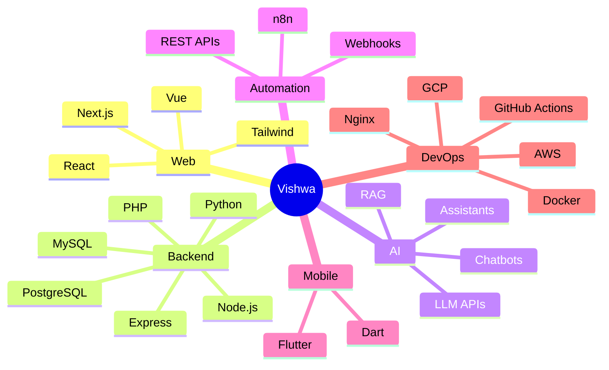
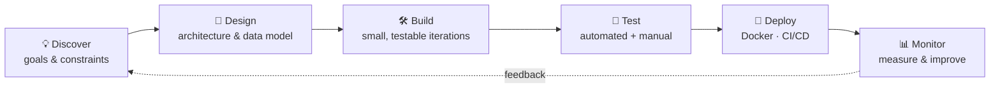
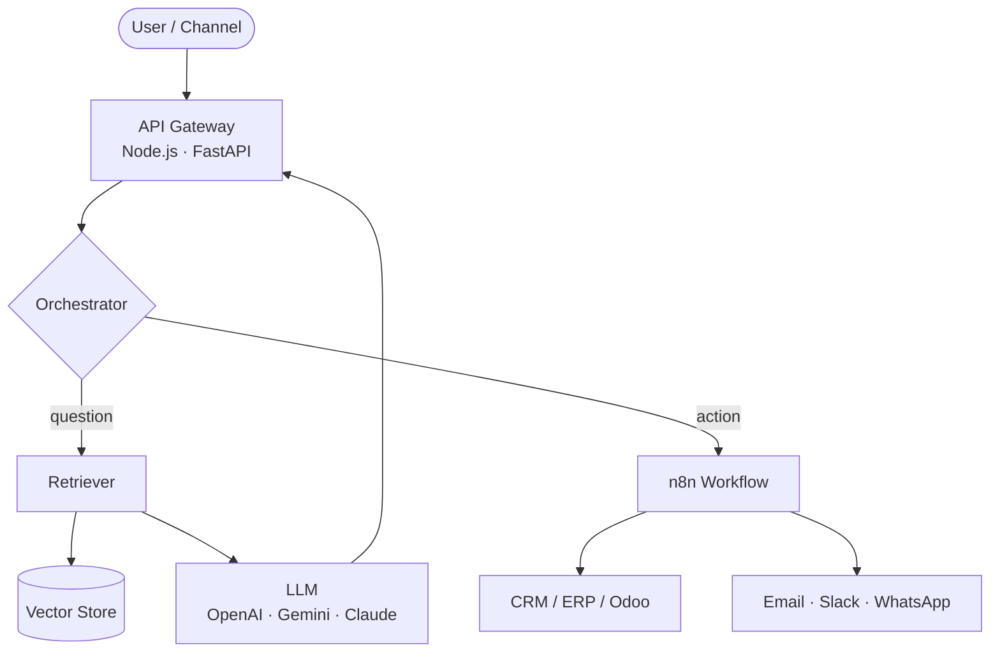

<!-- ═══════════════ HEADER BANNER ═══════════════ -->

 

  

<b>
<a href="#-about-me">About</a> ·
<a href="#-tech-stack">Stack</a> ·
<a href="#-services">Services</a> ·
<a href="#-featured-projects">Projects</a> ·
<a href="#-how-i-work">Process</a> ·
<a href="#-github-stats">Stats</a> ·
<a href="#-faq">FAQ</a> ·
<a href="#-lets-work-together">Contact</a>
</b>

---

## 👨‍💻 About Me

I'm a **full-stack developer and AI engineer** who enjoys owning a product from the first sketch to the production server. I design backends, build polished frontends, wire up LLMs, and automate the repetitive parts of business so teams can focus on what matters.

|  |  |
| :-- | :-- |
| 💻 **Full-stack** | Modern web apps, APIs, auth, databases, and backend services |
| 🤖 **AI engineering** | Assistants, chatbots, RAG pipelines, and LLM API integrations |
| ⚙️ **Automation** | n8n workflows, webhooks, REST APIs, business process automation |
| 📱 **Mobile** | Flutter and cross-platform applications |
| ☁️ **Cloud & DevOps** | Linux, Docker, Nginx, CI/CD, and cloud deployment |
| 🧩 **ERP & integrations** | Odoo modules and system-to-system integrations |

<b>⚡ Quick facts</b> (click to expand)

 

- 🔭 Currently building: AI-powered tools and automation workflows
- 🌱 Currently deepening: agentic AI patterns, RAG evaluation, and production observability
- 💬 Ask me about: n8n, RAG, Flutter, Next.js, Odoo, API design, deployment
- 🤝 Open to: freelance projects, collaborations, and full-time roles
- ⚡ Reply time: usually within a day
- 🎯 Philosophy: *ship small, measure, improve, repeat*

---

## 🧰 Tech Stack

### Languages

### Frontend

### Backend & Databases

### Mobile

### Cloud, DevOps & Tools

### AI, Automation & ERP

### 🗺️ Skill Map

---

## 🛠️ Services

| | Service | What you get |
| :-: | :-- | :-- |
| 🌐 | **Web applications** | Fast, accessible, SEO-friendly apps with clean architecture |
| 🔌 | **APIs & backends** | Secure REST APIs, authentication, database design, integrations |
| 🤖 | **AI assistants & chatbots** | Custom assistants grounded in your data using RAG |
| ⚙️ | **Business automation** | n8n pipelines that connect your tools and remove manual work |
| 📱 | **Mobile apps** | Flutter apps for Android and iOS from a single codebase |
| 🧾 | **Odoo customization** | Custom modules, payment logic, and ERP integrations |
| 🚀 | **Deployment & DevOps** | Dockerized setups, CI/CD, Nginx, SSL, monitoring |

---

## 🚀 Featured Projects

<table>
  <tr>
    <td width="50%" align="center">
      
       <b>Odoo · Python · ERP</b> — control which payment methods appear to which customers
    </td>
    <td width="50%" align="center">
      
       <b>Web · AI</b> — export and organize ChatGPT conversations
    </td>
  </tr>
  <tr>
    <td width="50%" align="center">
      
       <b>Flutter · Dart · Mobile</b> — cross-platform task manager
    </td>
    <td width="50%" align="center">
      
       <b>Next.js · React · Frontend</b> — fast, SEO-friendly blog
    </td>
  </tr>
</table>

  

---

## 🔄 How I Work

**Principles I stick to**

- ✅ Clear architecture before clever code
- ✅ Secure by default: validated input, scoped auth, secrets out of the repo
- ✅ Automate anything done more than twice
- ✅ Document so the next person (or future me) can move fast
- ✅ Ship early, gather feedback, iterate

---

## 🤖 Example: AI + Automation Architecture

A typical RAG assistant with workflow automation that I build for clients:

---

## 📊 GitHub Stats

 

  

### 🏆 Trophies

  

### 📈 Contribution Activity

  

### 🐍 Contribution Snake

  <picture>
    <source media="(prefers-color-scheme: dark)" srcset="https://raw.githubusercontent.com/thisisvishwa/thisisvishwa/output/github-snake-dark.svg">
    <source media="(prefers-color-scheme: light)" srcset="https://raw.githubusercontent.com/thisisvishwa/thisisvishwa/output/github-snake.svg">
    
  </picture>

---

## 🎯 Goals

- [x] Build and ship full-stack products end to end
- [x] Integrate OpenAI, Gemini, and Claude into real workflows
- [ ] Publish a production-grade open-source RAG starter kit
- [ ] Release a reusable library of n8n automation templates
- [ ] Write technical articles on AI engineering and automation
- [ ] Contribute to open-source projects I use every day

---

## ❓ FAQ

<b>Do you work on freelance projects?</b>

 
Yes. I take on web, AI, automation, mobile, and Odoo projects. Reach out with a short description of your goal and timeline.

<b>Can you take a project from idea to production?</b>

 
That's my favorite kind of work: architecture, development, deployment, and ongoing improvements.

<b>Which AI models do you work with?</b>

 
OpenAI, Google Gemini, and Anthropic Claude APIs, chosen based on cost, latency, and quality for the task.

<b>Can you automate my existing tools?</b>

 
Most likely. If your tools have an API or webhooks, I can connect them with n8n or custom services.

---

## 🤝 Let's Work Together

Have an idea, a bottleneck to automate, or a product to launch?

  

---

 

⭐ If something here helped you, consider starring a repository. Thanks for visiting!

